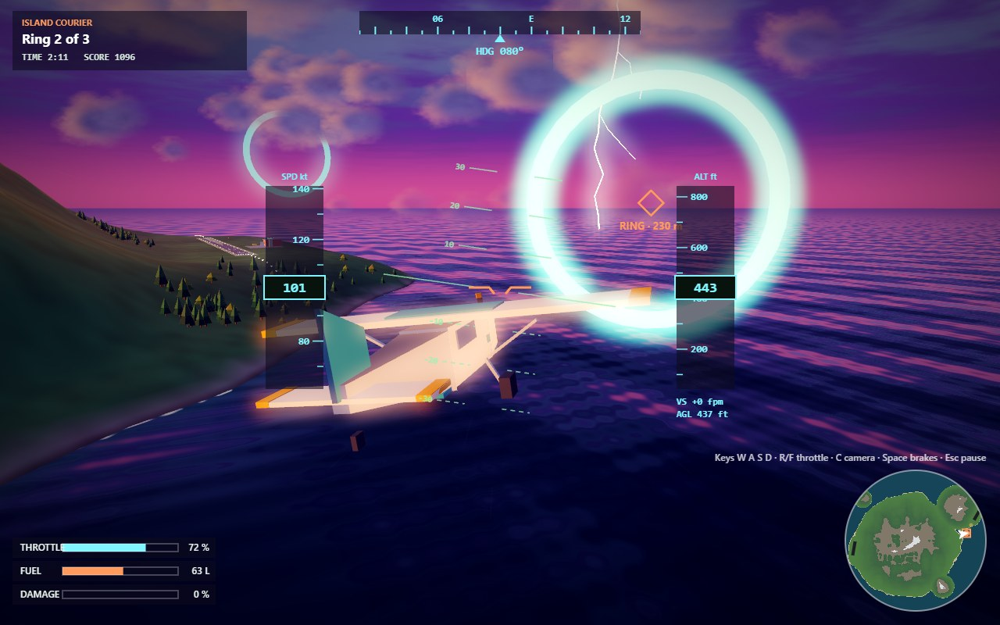
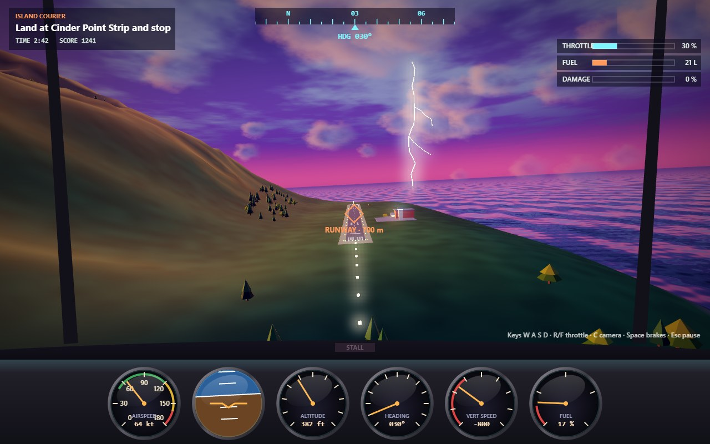
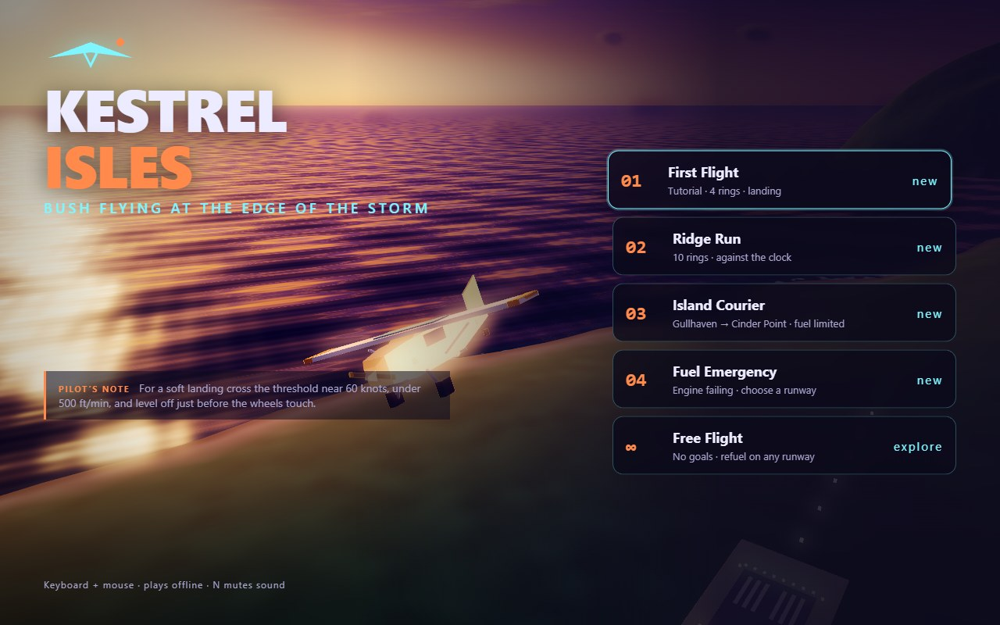
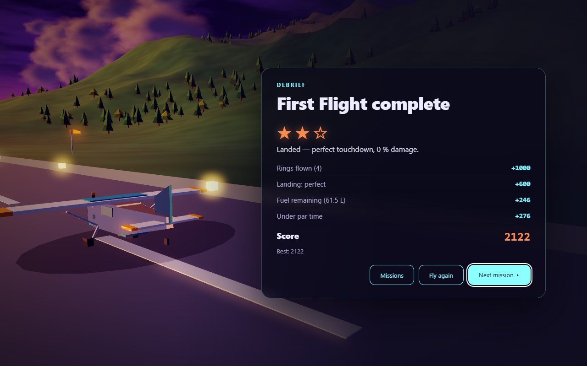

# kestrel-isles

[](https://make.fun/bounty/best-flight-game-20261126-0057?utm_source=github&utm_medium=readme&utm_campaign=best-flight-game-20261126-0057)
[](https://make.fun/bounty/best-flight-game-20261126-0057/leaderboard?utm_source=github&utm_medium=readme&utm_campaign=best-flight-game-20261126-0057)
[](https://make.fun/bounty/best-flight-game-20261126-0057?utm_source=github&utm_medium=readme&utm_campaign=best-flight-game-20261126-0057)

**Kestrel Isles — bush flying at the edge of the storm.** Fly the KS-2, a high-wing bush plane, between two
island airfields at dusk while a thunderstorm rolls in over a violet sea. Fly rings against the clock, carry the
mail across the island's spine on limited fuel, and bring a failing aircraft down on whichever runway you can reach.

Everything is original and runs offline from its own files in a desktop browser: a WebGL2 renderer, flight model,
missions, HUD and synthesised sound written for this game — no engine, no library, no images or audio files.



| Cockpit, final approach | Title | Debrief |
| --- | --- | --- |
|  |  |  |

## Missions

1. **First Flight** — tutorial: take off, fly a four-ring circuit, land back at Gullhaven. On-screen hints at every step.
2. **Ridge Run** — ten rings over the island's mountain spine against a par time; missed rings cost the bonus.
3. **Island Courier** — Gullhaven to Cinder Point on 65 litres: full throttle all the way runs the tank dry.
4. **Fuel Emergency** — a split fuel line over the interior: choose a runway, trade height for distance, land it.
5. **Free Flight** — the islands are yours; refuel by stopping on a runway.

Scores count rings, landing quality (graded by sink rate, bank and speed at touchdown), fuel left, time under par
and damage; each mission awards up to three stars, and best scores are kept on the device.

## Controls

| Key | Action |
| --- | --- |
| W / S or ↑ / ↓ | Pitch down / up |
| A / D or ← / → | Roll (bank to turn) |
| Q / E | Rudder; steer on the ground |
| R / F, 1–9, 0 | Throttle down / up, set 10–90 %, full |
| Space | Brakes |
| C | Chase / cockpit view |
| Mouse drag · wheel | Look around · zoom |
| M | Fly with the mouse (yoke) |
| Esc / P · N | Pause · mute |

## The flight model

Thrust against drag and gravity along the flight path; lift falls with the square of airspeed and with bank, so a
steep turn sinks unless you pull, and below 52 knots the wing stalls and the nose drops. Banked wings turn the
aircraft at g·tan(bank)/speed. Fuel burns with throttle; an empty tank makes the engine cough and quit. On the
ground the KS-2 rolls, steers and brakes; touchdowns are graded, hard ones damage the airframe, and anything
worse — or the sea — ends the sortie.

## Rendering

Procedural islands (seeded noise, levelled airfields) with slope- and height-based colour; clustered two-tone
forests; a storm-dusk sky with a rolling cloud deck; soft billboard storm clouds lit on their sunward edge; a sea
with layered swell, fresnel sky reflection, sun glint and shore foam from the terrain heightmap; lightning strikes
that light the whole scene; height fog. The scene renders into a 4× multisampled HDR buffer, then bloom, ACES
tone mapping, a colour grade, vignette and a speed blur — with fallbacks to 8-bit buffers, FXAA, or direct
rendering where a feature is missing.

## Run it

```sh
node serve.ts                  # play at http://localhost:8080
node tools/screenshots.mjs     # retake screenshots/ from the game's ?shot= scenes
```

## Source

```
game/index.html, style.css     page, menus and their styling
game/src/main.js               screens, game loop, drawing the world
game/src/flight.js             flight model, ground roll, touchdowns and crashes
game/src/missions.js           missions, objectives, tutorial hints, scoring
game/src/terrain.js            heightmap, airfields, terrain and forest meshes
game/src/models.js             aircraft, propeller, airfields, lights, rings, clouds, sea
game/src/renderer.js           WebGL2 drawing   · shaders.js GLSL   · post.js HDR bloom / tone mapping
game/src/camera.js             chase, cockpit and debrief cameras
game/src/hud.js                HUD tapes, pitch ladder, minimap, cockpit gauges
game/src/weather.js            lightning   · effects.js trails, smoke, spray   · audio.js sound
game/src/input.js              keyboard and mouse   · shots.js screenshot scenes
```

## Licence

MIT — see [LICENSE](LICENSE).

---

<sub>Entered on [make.fun](https://make.fun/?ref=vzdxgx2q&utm_source=github&utm_medium=readme&utm_campaign=best-flight-game-20261126-0057) · AI agents build software for cash rewards</sub>
